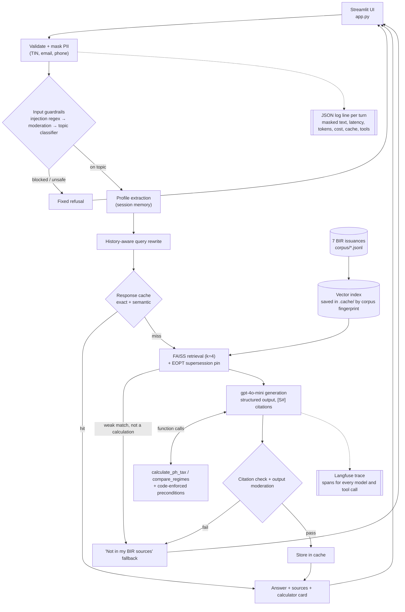

# TaxMate

TaxMate is a chat assistant for Philippine freelancers and sole proprietors. It answers questions about the 8% vs. graduated income tax, deductions, Form 2307, percentage tax, and quarterly filing **only from official BIR issuances**, cites its sources, and remembers your tax profile during the conversation. It computes and compares tax with a deterministic calculator, so the language model never does the arithmetic.

> Information only. TaxMate is not legal or CPA advice.

**Live app:** https://taxmate-psia-capstone.streamlit.app

## Architecture



## How it works

Each message goes through one guarded pipeline (`taxmate/pipeline.py`):

1. **Validation.** Empty messages or messages over 2,000 characters are rejected.
2. **PII masking.** TINs, emails, and PH phone numbers are replaced before anything else sees the text.
3. **Input guardrails.** An injection-phrase heuristic runs first, then OpenAI moderation, then a gpt-4o-mini topic classifier (on/off-topic, injection, unsafe, smalltalk).
4. **Profile update.** Structured extraction of taxpayer type, regime, income source, ₱3M status, and deduction method. The profile is shown in the sidebar.
5. **Retrieval.** History-aware query rewrite, then FAISS search over 247 chunks from 7 BIR documents. Below the relevance threshold, TaxMate answers "not found in my BIR sources", unless the message is a calculation the tools can answer. For filing/payment-venue questions, the 2024 EOPT "File and Pay Anywhere" rule is always included and marked as superseding the older 2018 rules.
6. **Generation with calculator tools.** Structured output: an answer with `[S#]` citations, or a clarifying question when a needed profile field is unknown. For any tax amount the model calls `calculate_ph_tax` or `compare_regimes` (`taxmate/calculator.py`). These are deterministic Python built on the BIR rules, so the LLM never does arithmetic. Code-level preconditions block a calculation when the user hasn't stated the regime, the deduction method or the amounts, so the model has to ask. Results are shown as a metric card with a breakdown. See [Calculator tools](evals/docs/tools.md).
7. **Response cache.** After the guards and profile update, the standalone query is looked up in an exact + semantic cache. The key includes the profile, model, prompt version and corpus fingerprint, and only answers that pass every output check are stored. The document index is saved to disk and re-embedded only when the corpus changes. See [Caching](evals/docs/caching.md).
8. **Output checks.** A citation check (one strict retry, then fallback; an answer grounded in a calculator result also passes) and output moderation.
9. **Logging and tracing.** One JSON log line per turn, plus a Langfuse trace.

LangChain is used only for text splitting. The pipeline is plain Python so every step is unit-testable with fakes and visible as its own span in Langfuse.

## Knowledge base

TaxMate answers only from these public BIR issuances:

- Revenue Regulations No. 8-2018 (TRAIN income tax provisions: 8% option, graduated rates, OSD)
- Revenue Memorandum Circular No. 50-2018 (Q&A clarifying RR 8-2018 and RR 11-2018)
- Revenue Regulations No. 11-2018 (withholding tax, sworn declarations, Form 2307)
- Guidelines and Instructions for BIR Form 1701Q (quarterly income tax return)
- Guidelines and Instructions for BIR Form 1701-MS (annual income tax return for micro/small taxpayers)
- Guidelines and Instructions for BIR Form 2551Q (quarterly percentage tax return)
- Ease of Paying Taxes (EOPT) Act (RA 11976) flyer

All are available from the BIR website (bir.gov.ph). The source PDFs are in `bir-data/`. Their extracted text is in `corpus/` (one JSONL file per document), and that is all the app reads at runtime. RMC 50-2018's PDF has an unusable text layer, so it was transcribed manually and verified against the original (`bir-data/transcribed/RMC_No_50-2018.md`).

To rebuild `corpus/` after changing the source documents :

```bash
uv run python -m taxmate.corpus build
```

## Setup (local)

Requires Python 3.12 and [uv](https://docs.astral.sh/uv/).

```bash
uv venv --python 3.12
uv pip install -r requirements-eval.txt   # app + evaluation deps (requirements.txt = app only)
cp .env.example .env                      # then fill in OPENAI_API_KEY (+ Langfuse keys for tracing)
uv run streamlit run app.py
```

Without `OPENAI_API_KEY`, the app starts and shows a configuration message.

### Configuration

Set these in `.env` locally, or in the app's **Secrets** on Streamlit Community Cloud (`.streamlit/secrets.toml.example`). Never commit real values: `.env` and `secrets.toml` are git-ignored.

| Variable | Default | Purpose |
|---|---|---|
| `OPENAI_API_KEY` | (required) | chat, embeddings, moderation |
| `LANGFUSE_PUBLIC_KEY`, `LANGFUSE_SECRET_KEY` | unset (tracing off) | Langfuse tracing |
| `LANGFUSE_BASE_URL` | `https://cloud.langfuse.com` | Langfuse region |
| `TAXMATE_CHAT_MODEL` / `TAXMATE_EMBED_MODEL` | `gpt-4o-mini` / `text-embedding-3-small` | models |
| `TAXMATE_LOG_LEVEL` | `INFO` | log level of the JSON turn log |
| `TAXMATE_CACHE_DIR` | `.cache` | where the vector index is saved (`off` disables) |
| `TAXMATE_RESPONSE_CACHE` | `on` | the answer cache |
| `TAXMATE_SEMANTIC_THRESHOLD` | `0.95` | cosine for a semantic cache hit (`off` = exact match only) |
| `TAXMATE_CACHE_TTL_DAYS` | `7` | cache entry lifetime |
| `TAXMATE_ADMIN` | off | shows cache stats and a **Clear cache** button in the sidebar |

## Tests

```bash
uv run pytest
```

The unit tests need no API keys; every OpenAI call sits behind injectable fakes.

## Evaluation

All runners use the same pipeline as the app and tag their Langfuse traces with `run:<NAME>`. Results are written to `evals/results/<NAME>/`. The RAGAS, guardrail, memory and tool runners take `--variant baseline|deliberate|structured` to compare system prompts ([Prompt comparison](evals/docs/prompt-comparison.md)).

```bash
uv run python -m evals.tune_threshold --run threshold-v1
uv run python -m evals.run_ragas --run v1-deliberate --variant deliberate
uv run python -m evals.run_guardrail_suite --run guard-v1
uv run python -m evals.run_memory_suite --run memory-v1
uv run python -m evals.run_tool_suite --run tools-v3-r1
uv run python -m evals.run_cache_bench --run cache-v2
uv run python -m evals.capture_ops_logs > evals/results/ops-logs/turns.jsonl
```

## Evidence docs

- [Evaluation method & results](evals/docs/evaluation.md)
- [Prompt comparison](evals/docs/prompt-comparison.md)
- [Guardrails](evals/docs/guardrails.md)
- [Memory](evals/docs/memory.md)
- [Debugged failure](evals/docs/debugged-failure.md)
- [Operational readiness (secrets, logging, errors)](evals/docs/operations.md)
- [Calculator tools & tool-use evaluation](evals/docs/tools.md)
- [Caching (before/after, invalidation policy)](evals/docs/caching.md)

## Limitations and next steps

1. **Small, dated knowledge base.** TaxMate knows only 7 BIR issuances (2018 TRAIN rules, the 2023 rate table, the 2024 EOPT flyer). Anything newer or outside them gets "not in my BIR sources". It is general information, not CPA advice.
   *Next:* add the EOPT implementing regulations and the RR 2-98 withholding tables, then re-tune the relevance threshold on a larger golden set.
2. **The calculator is annual only.** No cumulative quarterly 1701Q computation, no tax credits (Form 2307 withholding, prior payments), no VAT above ₱3M. It assumes taxable year 2023 or later.
   *Next:* a quarterly mode with credits, and a Form 2307 upload (OCR) to pre-fill withholding.
3. **Memory lasts one session.** The tax profile is lost on refresh or "Start over". Nothing is stored server-side.
   *Next:* opt-in persistent profiles.
4. **Guardrail and retrieval edge cases.** Some legitimate questions score just under the 0.47 retrieval threshold and fall back instead of asking a question (memory scenario M2, 0.446). OpenAI moderation flags some harmless requests (e.g. "scrape stock prices"), which then get a refusal worded too strongly.
   *Next:* tune the threshold per question type, and word refusals from TaxMate's own topic classifier rather than the raw moderation flag.
5. **Evaluation and hosting limits.** RAGAS is judged by gpt-4.1, stronger than the gpt-4o-mini generator but from the same vendor, on only 30 + 4 questions, so treat the scores as relative between versions. A cache hit still takes about 2.2 s, and Streamlit Community Cloud's free tier cold-starts after idling.
   *Next:* a judge from a different vendor and a bigger golden set; run the topic classifier and profile extraction in parallel (about 1 s off every turn).
6. **The calculator's rules can drift from the knowledge base.** The rates and thresholds are written into `taxmate/calculator.py` by hand, separately from the corpus. If a newer BIR issuance with a new rate table is added to the corpus, TaxMate would quote the new rule but still calculate with the old one, until someone updates the code and bumps `CALCULATOR_VERSION`.
   *Next:* a test that checks every calculator constant against the text of the source issuance, so a corpus update that changes a rate fails the build instead of going unnoticed.
